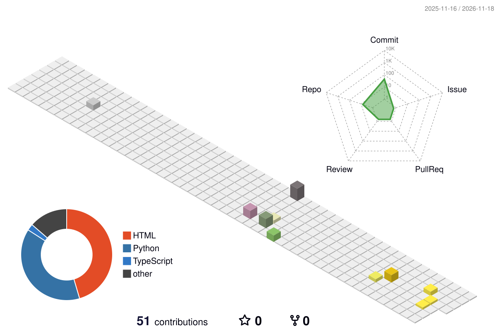

<!--
  Maintenance notes (repo owner):
  - Repository Settings → Actions → General → Workflow permissions must be set to "Read and write permissions".
  - 3D contribution graph: generated by .github/workflows/3d-contrib.yml and committed to this branch.
  - Snake animation: generated by .github/workflows/snake.yml and published to the `output` branch.
-->

  

  

---

## 💫 About Me

<table>
  <tr>
    <td width="58%" valign="top">

🔭 **Currently building** Python & Flask web applications

🤝 **Open to collaborate on** open-source, backend, and full-stack projects

🧠 **Exploring** system design, scalability, and clean architecture

🌱 **Learning** advanced Python, REST APIs, databases, and cloud fundamentals

💬 **Ask me about** Python, Flask, PHP, JavaScript, and backend logic

⚡ **Fun fact** I enjoy turning real-world problems into simple, working solutions

</td>
    <td width="42%" valign="top" align="center">

</td>
  </tr>
</table>

  
<b>🎯 My Current Goals</b> — click to expand 👀

   

  - [ ] Master advanced Python & clean backend architecture
  - [ ] Ship 3 production-level APIs
  - [ ] Learn cloud deployment (CI/CD, AWS basics)
  - [ ] Contribute to open source 🌍

---

## 🌐 Connect With Me

    

---

## 🛠️ Tech Stack

  

  

---

## 🚀 Featured Projects

<table>
  <tr>
    <td width="50%" align="center">
      
       
      <a href="https://flowdraw.antideploy.app/"><b>🔗 Live Demo</b></a>
    </td>
    <td width="50%" align="center">
      
       
      <a href="https://om-shukla.vercel.app"><b>🔗 Live Demo</b></a>
    </td>
  </tr>
  <tr>
    <td width="50%" align="center">
      
       
      <a href="https://cognevance-job-portal-blond.vercel.app"><b>🔗 Live Demo</b></a>
    </td>
    <td width="50%" align="center">
      
       
      <a href="https://cognevance-blog-website.vercel.app"><b>🔗 Live Demo</b></a>
    </td>
  </tr>
</table>

**More projects:** [AI-Powered Chatbot](https://github.com/omshukla-tech/codectechnologies_AI_Powered_Chatbot) · [Secure Authentication System](https://github.com/omshukla-tech/codectechnologies_Secure_Authentication_System)

---

## 📊 GitHub Stats

---

## 📈 Contribution Activity

---

## 🧊 My Contributions in 3D

---

## 🐍 Snake Eating My Contributions

<picture>
  <source media="(prefers-color-scheme: dark)" srcset="https://raw.githubusercontent.com/omshukla-tech/omshukla-tech/output/github-snake-dark.svg"/>
  <source media="(prefers-color-scheme: light)" srcset="https://raw.githubusercontent.com/omshukla-tech/omshukla-tech/output/github-snake.svg"/>
  
</picture>

---

## 📌 Profile Summary

---

## ✍️ Dev Quote of the Day

---

  

